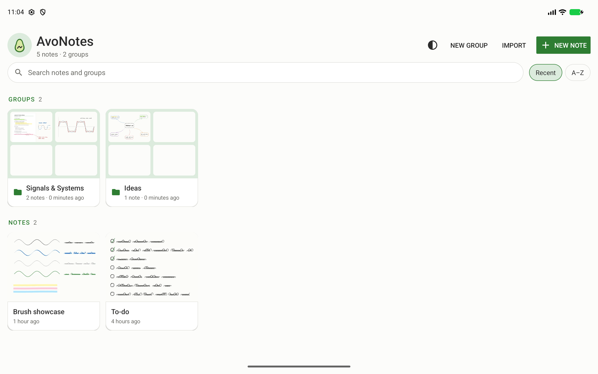
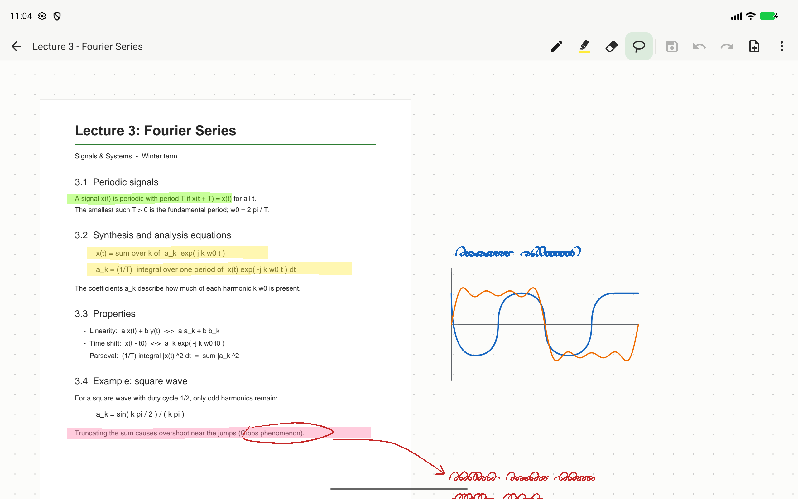
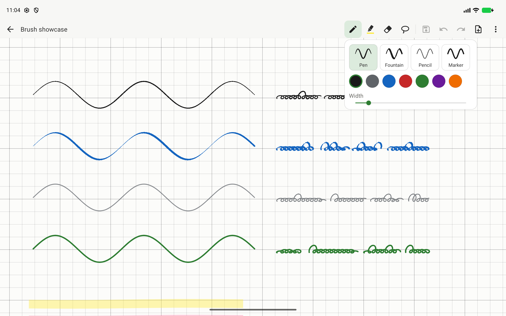
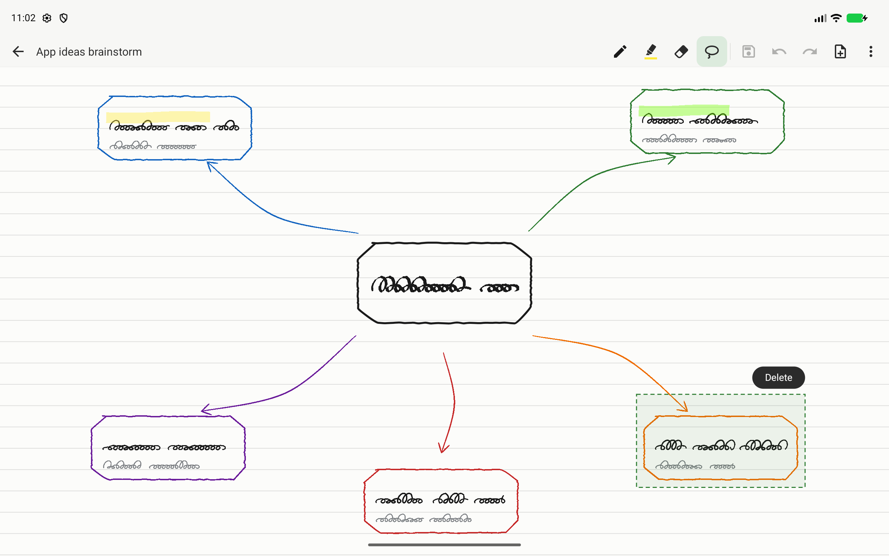
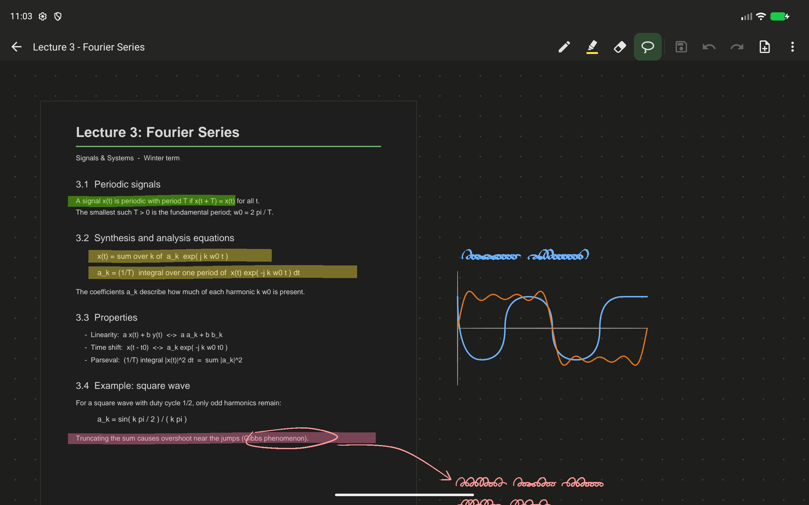
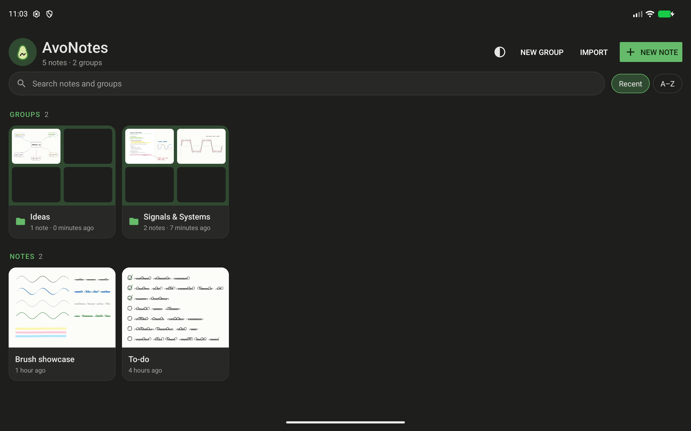

# AvoNotes

> [!WARNING]
> **This app is AI-generated.** The code, documentation, demo content and screenshots in this
> repository were written by an AI coding assistant (Claude, by Anthropic), directed and tested by a
> human. It is alpha software: expect rough edges, and keep backups of notes you care about.

[](https://github.com/Avolord/AvoNotesApp/actions/workflows/ci.yml)
[](https://github.com/Avolord/AvoNotesApp/releases)


[](LICENSE)

A small, fast, native Android note-taking app for stylus users: an **infinite canvas**, **PDF
annotation**, and plain **save/load**. No accounts, no cloud, no ads, no subscriptions, no tracking:
the app asks for **zero permissions** and never touches the network.



## Features

| | |
| --- | --- |
|  | **Annotate PDFs.** Import a PDF and its pages land on the canvas; write, highlight and sketch around them. Pages render in the background and get sharp again at any zoom. |
|  | **Brushes.** Pressure-sensitive **Pen**, calligraphic **Fountain** pen, **Pencil** (pressure sets darkness), even **Marker**, plus a **Highlighter**. Pick one with a live preview in your current color. |
|  | **Lasso and edit.** Loop around ink to select it, then drag to move it, pull a corner to resize it, or use the round handle to rotate it. Copy, paste (even into another note), duplicate or delete it. Long-press a PDF page to move or resize it together with its annotations. Everything is undoable. |
|  | **Dark mode.** The whole app, including the canvas: PDF pages and ink are shown with inverted lightness (hues kept), so annotations stay readable. Your notes are stored unchanged. |
|  | **Organized library.** Groups, search across everything, sort by recent or A–Z, and previews of every note. |

More:

- **Infinite canvas** with smooth pan and pinch-zoom (2%–4000%), palm rejection while the pen is down,
  and the S Pen button or eraser tip for erasing.
- **Two erasers:** remove whole strokes, or erase partially to cut away just the ink under the eraser.
  The size is adjustable.
- **Backgrounds per note:** dots (default), lines, grid or blank.
- **Saving your way:** auto-save (default) or manual save with an unsaved-changes prompt.
- **Your files, your device:** notes live in the app's storage; export any note as an `.avonote`
  file (a zip with the ink and its PDFs), or a whole group as an `.avogroup` file, and import it
  anywhere.
- **Backups:** save everything (notes, groups, PDFs) as one `.avobackup` file, and restore it later
  either by replacing your library or by merging it into what's already there.
- **Export to PDF:** the whole canvas on one page (ink stays vector, at real size), or, for notes with
  imported PDFs, one page per PDF page with your annotations on it.
- Keyboard and mouse support: Ctrl+Z / Ctrl+Y, Ctrl+C / Ctrl+X / Ctrl+V, Ctrl+D (duplicate), Del,
  mouse-wheel pan, Ctrl+wheel zoom.

## Install

### Download the APK

Grab `AvoNotes-<version>.apk` from the [Releases](https://github.com/Avolord/AvoNotesApp/releases)
page and open it on your device (allow installing from your browser or file manager when asked).

Release APKs are signed with this certificate:

```
SHA-256: 8C:62:1D:90:A9:B9:15:49:69:F7:E8:BE:C1:F0:AA:F7:C2:5E:EA:2A:98:B5:2A:A7:8B:00:6C:37:AD:36:33:39
```

### F-Droid (recommended, with automatic updates)

AvoNotes has its own F-Droid repository, built from the GitHub releases. Open
**<https://avolord.github.io/AvoNotesApp/>** on your device and tap **Add to F-Droid**, or add it by hand
in F-Droid, Droid-ify or Neo Store:

| | |
| --- | --- |
| Address | `https://avolord.github.io/AvoNotesApp/repo` |
| Fingerprint | `86D81156D7F9FB9BF4F81898CC302FA3305B2867B31A5EC509632B1F5DF94EEF` |

### Obtainium

Add `https://github.com/Avolord/AvoNotesApp` to [Obtainium](https://github.com/ImranR98/Obtainium)
(enable "Include prereleases" while the app is in alpha) to install new releases straight from GitHub.

## Requirements

| | |
| --- | --- |
| **Device** | Android 11 (API 30) or newer. Built and tested on a Galaxy Tab S10 FE+ (Android 16). |
| **Input** | A stylus is recommended (pressure, palm rejection, side button). Finger drawing can be turned on in the More menu. |
| **Building** | JDK 17+ (Android Studio's bundled JBR works) and the Android SDK with platform 36. |

## Technologies

- **Kotlin 2.2** on the plain **Android SDK**: no AndroidX, no AppCompat, no third-party libraries.
  The release APK is about 175 KB.
- **Rendering:** a custom `View`. Strokes are grouped into world-space tiles, each recorded once into a
  GPU **`RenderNode`** display list, so panning and zooming just replay them. Ink stays vector-sharp
  at any zoom, and an edit only re-records one tile.
- **PDF:** the platform **`PdfRenderer`** on a background thread, with power-of-two level-of-detail
  bitmaps in an LRU cache, plus screen-resolution patches for deep zoom.
- **Storage:** a compact binary format with atomic writes, one folder per note. Import and export
  use the **Storage Access Framework**, which is why the app needs no storage permission.
- **Theming:** platform night resources and `UiModeManager` app-level night mode.
- **Build and CI:** Gradle 8.14, Android Gradle Plugin 8.11, **GitHub Actions** (lint, debug and
  release builds on every push; signed release APKs from version tags).

## Using it

- **Stylus** draws. The S Pen side button or an eraser tip erases.
- Tap the active eraser again (or long-press it) to choose **Whole stroke** or **Partial** erasing and
  the eraser size. Partial erasing splits a stroke where you erase through it; one undo restores it.
- **One finger** pans, **two fingers** pinch-zoom.
- Tap the active pen or highlighter again (or long-press it) for brush, color and width. The pen icon
  shows the current ink color; the marker shows it as a swatch.
- **Lasso:** draw a loop around ink to select it (a stroke counts if at least half of it is inside;
  PDF pages count if fully inside). Then:
  - drag inside the selection to move it;
  - drag a **corner handle** to resize it (the opposite corner stays put; lines get thicker or
    thinner with it);
  - drag the **round handle** to rotate it (it snaps to 45° steps; pages can't be rotated);
  - **Copy**, **Duplicate** or **Delete** with the buttons under it. To paste, long-press empty space
    (with a finger) and tap **Paste**. Copied ink can be pasted into other notes too; PDF pages only
    into the note they came from.
  - Tap outside to deselect.
- **Long-press a PDF page** with a finger (or the pen in lasso mode) to pick it up and move it; its ink
  comes along. Deleting a page keeps the handwriting that was on it.
- **More** panel: zoom to fit or 100%; rename the note and pick its background; and the settings
  (draw with finger, auto-save, theme). Everything applies right away.
- **Saving:** with auto-save on (default), notes save 1.5 s after each change and when you leave. With
  it off, use the Save button. Leaving with unsaved changes asks to Save, Discard or Cancel.
  (Closing the window from the system, rather than with back, can't be intercepted.)
- **Export as PDF:** from a note's More panel, or long-press it in the library. Imported PDF pages are
  re-rendered as images (about 200 dpi), so their text isn't selectable in the export.
- **Library:** long-press a note to rename, duplicate, move to a group, export (`.avonote` or PDF)
  or delete it. Long-press a group to rename it, duplicate it (with copies of its notes), export it
  with all its notes (`.avogroup`), or delete it (its notes are kept). Exporting a single note
  always exports only that note.
- **Backup and restore:** the ⋮ menu in the library header. Restoring first checks the backup, then
  offers **Merge** (keeps your notes; notes already here are skipped, changed ones come in as
  copies, and groups with the same name are combined) or **Replace everything** (after a
  confirmation, the library becomes exactly the backup). Picking a backup with **Import** works too.
  **Import** loads an `.avonote` file into the group you're viewing, or an `.avogroup` file as a new
  group.

## Building

```bash
./gradlew assembleDebug     # app/build/outputs/apk/debug/app-debug.apk (id com.avonotes.debug)
```

```bash
./gradlew installDebug      # onto a connected device
```

```bash
./gradlew lintDebug         # what CI runs first
```

Debug builds use the application ID `com.avonotes.debug`, so they install next to the released
`com.avonotes`.

### Signed release builds

`./gradlew assembleRelease` signs the APK when a keystore is configured, either through a git-ignored
`keystore.properties` in the project root:

```properties
storeFile=/path/to/avonotes-release.jks
storePassword=...
keyAlias=avonotes
keyPassword=...
```

or through the environment variables `AVONOTES_KEYSTORE`, `AVONOTES_KEYSTORE_PASSWORD`,
`AVONOTES_KEY_ALIAS` and `AVONOTES_KEY_PASSWORD`. Without either, the release APK is left unsigned.

### CI and releases

- **[CI](.github/workflows/ci.yml)** runs on every push and pull request: lint, debug and release
  builds, with the debug APK and lint report uploaded as artifacts.
- **[Release](.github/workflows/release.yml)** runs when a `v*` tag is pushed. It builds a signed APK
  and publishes it as a GitHub release (marked as a pre-release for `alpha`/`beta`/`rc` tags). It
  needs the repository secrets `AVONOTES_KEYSTORE_BASE64` (the base64-encoded `.jks`),
  `AVONOTES_KEYSTORE_PASSWORD`, `AVONOTES_KEY_ALIAS` and `AVONOTES_KEY_PASSWORD`. Without them the
  workflow skips signing and says so.
- **[F-Droid repo](.github/workflows/fdroid.yml)** runs after each release (or by hand). It collects the
  APKs from all GitHub releases, builds a signed F-Droid index with `fdroidserver` (using the
  `avonotes-fdroid` key in the same keystore and the same secrets), and publishes it with GitHub
  Pages. The app's store listing is in [`fdroid/metadata/com.avonotes.yml`](fdroid/metadata/com.avonotes.yml),
  and the screenshots come from `docs/screenshots/`.

## How it's put together

| File | What it does |
| --- | --- |
| `canvas/InfiniteCanvasView.kt` | Input (stylus, palm rejection, pan/zoom), lasso and selection, undo/redo, background patterns, frame rendering |
| `canvas/TileIndex.kt` | Strokes bucketed into 1024-unit world tiles, each recorded once into a `RenderNode` |
| `canvas/StrokeRenderer.kt` | The brushes: variable-width runs for pen and fountain, single paths for pencil, marker and highlighter |
| `canvas/DarkInk.kt` | Dark-mode color mapping shared by ink and PDF pages |
| `pdf/PdfPageCache.kt` | Background PDF rendering, LOD cache, deep-zoom patches |
| `io/NoteStore.kt` | Storage: notes, groups, previews, import/export |
| `io/Thumbnailer.kt` | Library previews |
| `io/PdfExporter.kt` | PDF export (whole canvas, or annotated PDF pages) |
| `ui/` | Library and canvas screens, popup panels and dialogs (platform widgets only) |

World units are PDF points (1/72 inch). At 100% zoom, 1 unit = 1 dp.

### Storage layout

```
files/notes/<uuid>/note.avn        binary ink, PDF placement and viewport (big-endian, versioned)
files/notes/<uuid>/title.txt       name
files/notes/<uuid>/background.txt  paper pattern (absent = dots)
files/notes/<uuid>/group.txt       group id (absent = no group)
files/notes/<uuid>/thumb.webp      library preview (regenerated when stale)
files/notes/<uuid>/pdf/<id>.pdf    embedded PDFs
files/groups.tsv                   group id <TAB> name
```

## Known limits and ideas

- The clipboard is in-app only and is cleared when the app is closed.
- Zoomed far out on very large notes, a bitmap level of detail would help performance.

## License

[MIT](LICENSE): use, modify and redistribute it freely, as long as the copyright notice comes along.
